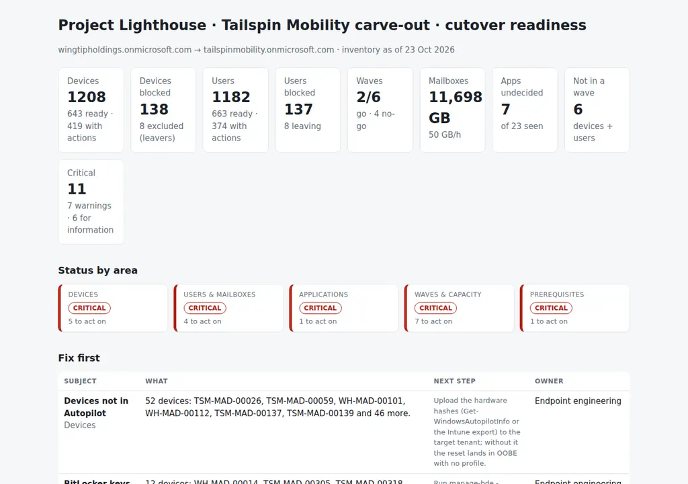

# Tenant Separation Cutover Planner

The readiness review for a Microsoft 365 tenant separation (a carve-out or a tenant-to-tenant migration), built from the source tenant's exports: which devices can be reset into the target with Autopilot and which cannot (no hardware hash, no BitLocker key escrowed, not Windows 11 capable, not seen for weeks), which users will fail on day 1 (no MFA, a licence nobody has bought in the target, a mailbox too big for the window), which applications still have no decision, and whether each wave is a **go, a go with actions, or a no-go**, with the reason: capacity, blocked share, mailbox hours against the window, a freeze, or an unfinished target tenant. Two CSVs, one JSON with the waves and rules, one Python command, and the cutover plan for the change board.

Python 3.10+, standard library only. Runs with fictional demo data out of the box; a read-only PowerShell exporter for Microsoft Graph (and Exchange Online) is included.



## Why

A tenant separation is a thousand small resets that all have to work on the same weekend. The programme plan says "wave 3, Milan, 30 November"; the inventory says a third of the plant's devices have no TPM, 14 kiosks have no primary user, 94 devices run an HMI application nobody has catalogued, and the mailboxes of that wave need 58 hours of migration for a 72-hour window. None of that is visible in the project tracker, and all of it is in the Intune, Entra and Exchange exports.

The planner reads those exports and turns them into the three things the weekly readiness review needs:

- a **blockers list with owners**: hardware hashes to upload, keys to escrow, devices to replace or exempt, MFA to register, SKUs to buy, apps to decide;
- a **go / no-go per wave** with the structural reasons (capacity, window, freeze, prerequisites), so the wave design changes before the date, not on it;
- a **cutover plan** (`cutover-plan.md`) with the prerequisites checklist, each wave's numbers and the order of the day, ready to attach to the change.

The rules are written down in `settings.json` and `cutover/checks.py`; the same inventory gives the same answer every week, and the counts should fall.

## What it checks

| Area | Code | Finding | Blocks a wave? |
|---|---|---|---|
| Devices | DEV-01 | Not registered in Autopilot (no hardware hash in the target) | device blocked |
| Devices | DEV-02 | BitLocker recovery key not escrowed in Entra | device blocked |
| Devices | DEV-03 | Hardware not Windows 11 capable (TPM 2.0, Secure Boot, RAM) | device blocked |
| Devices | DEV-04 | Not seen for 4× `last_seen_max_days` (probably retired) | device blocked |
| Devices | DEV-05 | Domain-only, workgroup or registered devices (full reset, no in-place move) | action |
| Devices | DEV-06 | Local administrators the reset will remove | action |
| Devices | DEV-07 | Devices of leavers | excluded |
| Devices | – | OS build below baseline, low disk, non-compliant, no management agent, kiosk/shared, apps undecided | action |
| Users | USR-01 | No MFA method registered (Conditional Access in the target) | user blocked |
| Users | USR-02 | Mailbox over `mailbox_max_gb` (pre-stage a week before) | user blocked |
| Users | USR-03 | Licence with no target SKU in `licence_map` | user blocked |
| Users | USR-04 | Shared mailboxes with members in several waves | action |
| Users | USR-05 / 06 | Dormant users, leavers | action / excluded |
| Applications | APP-01 / 02 | Apps without a target decision; blocked apps | action |
| Waves | WAV-01 | No-go: over capacity, blocked share over the limit, mailbox hours over the window, in a freeze, pilot with prerequisites open | wave |
| Waves | WAV-02 | Go with actions: the wave is sound but devices or users in it are still blocked | wave |
| Waves | WAV-03 / 04 | Devices and users in no wave; VIP devices needing a white-glove slot | – |
| Prerequisites | PRE-01 | Target tenant checklist not complete | pilot |

Thresholds, wave design, freeze windows, the application catalog, the licence map and the prerequisites live in `settings.json` ([docs/data-format.md](docs/data-format.md)).

## Outputs

| File | What |
|---|---|
| `report.html` | Tiles, status by area, "Fix first", the waves table with verdicts and reasons, prerequisites, blocked devices and users, the application catalog, all findings |
| `cutover-plan.md` | The plan for the change board: summary, prerequisites checklist, one section per wave with numbers and reasons, the order of the cutover day, findings |
| `waves.csv` | One row per wave: devices, users, blocked, capacity, days needed, mailbox GB and hours, VIPs, verdict, reasons |
| `blockers.csv` | One row per blocked device or user with the blocker, an `owner` column and a `cleared` column to work through |
| `device-readiness.csv`, `user-readiness.csv` | Every device and user with its wave, verdict, blockers, actions and notes |
| `apps.csv` | Every application seen, how many devices, and the catalog decision |
| `actions.csv`, `findings.csv` | The findings with owner and next step, in a shape that pastes into a tracker |

## Try it

```bash
git clone https://github.com/inigogonzalezgarcia/29-tenant-separation-cutover-planner.git
cd 29-tenant-separation-cutover-planner
python -m cutover demo
```

Open `output/report.html` and `output/cutover-plan.md`.

### The demo data

The demo is a made-up carve-out, Project Lighthouse: Tailspin Mobility, an automotive dealer group being separated from its parent, Wingtip Holdings, into its own tenant. Four sites (Madrid 520 devices, Milan plant 290, Lisbon 210, Warsaw 160), 1,208 devices and 1,182 users, with the inventory taken on 23 October 2026 and six waves from 9 November to 28 December. Names, tenants, sizes and events are invented.

The problems are placed on purpose:

- **Pilot (W0, Madrid IT):** clean, but no-go until the last prerequisite (service desk briefed, hypercare rota) is done.
- **Warsaw (W1):** go with actions: 16 devices and 15 users still blocked, mostly Autopilot hashes and MFA.
- **Lisbon (W2):** no-go: 208 devices for a capacity of 150 (two technicians, three days), plus Finance on Sage 50 with no decision.
- **Milan (W3):** no-go: a third of the plant's devices are not Windows 11 capable (25% of the wave blocked), 14 kiosks, a plant HMI application and a label-printer utility nobody has catalogued, and 302 devices against a capacity of 300.
- **Madrid A (W4, Finance/Sales/Marketing/Legal/HR):** go with actions: the VIPs, 20 mailboxes over 50 GB to pre-stage, shared mailboxes split with Madrid B.
- **Madrid B (W5):** no-go: it falls in the year-end freeze.
- Across the tenant: 52 devices not in Autopilot, 12 BitLocker keys not escrowed, 54 users without MFA, 68 users on Visio Plan 2 with no SKU in the target, 7 applications undecided, 81 domain-only devices, 22 devices not seen for two months, 6 devices in Athens that match no wave, 8 leavers.

## Use it with your own data

1. Export the source tenant to `data/devices.csv` and `data/users.csv`:
   ```powershell
   .\scripts\Export-TenantInventory.ps1 -OutputFolder .\data -IncludeMailboxes
   ```
   - It is read-only: Graph with read scopes, Exchange Online for mailbox sizes if asked; nothing is written and no credential is stored.
   - TPM, Secure Boot and RAM are not in Graph: merge the Windows 11 hardware readiness report (or ConfigMgr inventory) on the device name. Without those columns the planner assumes the hardware is capable.
   - Site, VIP, Leaving and Installed apps come from HR and the application inventory; the exporter leaves those columns for you. Any CSV with the right columns works ([docs/data-format.md](docs/data-format.md) lists the aliases).
2. Write `data/settings.json`: the waves (sites, departments, date, days, technicians, pilot), freeze windows, thresholds, the application catalog, the licence map and the target tenant prerequisites.
3. Build the outputs:
   ```bash
   python -m cutover plan data/ --title "Project Lighthouse · cutover readiness" --as-of 2026-10-23
   ```
4. Run it again every week; keep the dated output folders so the trend is visible. [docs/cutover-runbook.md](docs/cutover-runbook.md) has the cadence, how to read the verdicts and the usual fix per finding.

The export names people, devices and mailboxes. Keep it inside your organisation:

- real files at the top level (`devices*.csv`, `users*.csv`, `settings.json`, `data/`) and the `output/` folder are excluded from Git by `.gitignore`;
- only the fictional files in `sample_data/` are committed;
- the exporter reads device and user attributes; it never reads mail, files or recovery key values (only whether a key exists).

## Tests

```bash
pip install -r requirements-dev.txt
python -m pytest -q
```

22 tests: column aliases and value parsing (yes/no, dates, OS builds and release names), the device blockers and actions, leaver exclusion, user blockers (MFA, mailbox, licence), shared mailboxes across waves, the wave assignment rules (site and department, devices without a user), capacity and days needed, freeze, blocked share and mailbox window, the pilot prerequisites, the findings and their ordering, and the demo end to end (deterministic, all nine outputs).

## Next steps

- Read the inventories straight from Graph instead of a CSV, with the hardware readiness report joined in.
- A wave re-balancer: move blocked devices to the next wave and re-run until every wave is a go.
- Per-wave communication drafts (what the user does before, on the day, after) from the same data.
- A trend view across weekly runs.

## Background

Built from my work on end-user computing and Microsoft 365, including:

- tenant-to-tenant migrations and the Microsoft 365 administration behind them (Entra ID, Conditional Access, Exchange Online, licensing);
- Windows Autopilot and Intune with ConfigMgr co-management, and a Windows 11 migration across sites;
- change management through the CAB, with freeze windows and go / no-go reviews;
- dealer and venue environments (DMS, POS, kiosks, shared devices) where legacy applications are part of the estate;
- working with providers and onsite teams on capacity for site cutovers.

Written from scratch with fictional data; no employer data, inventories or tenants are used.

## Customisation and contact

Want this adapted to your programme? For example:

- your exports as they are (Intune, ConfigMgr, a CMDB) instead of the CSV layout;
- your wave rules (by building, by manager, by application group) and your freeze calendar;
- Mac and mobile devices alongside Windows;
- the plan rendered into your change template.

Get in touch:

- Website (contact form): [inigogonzalezgarcia.github.io](https://inigogonzalezgarcia.github.io/about.html#contacto)
- LinkedIn: [linkedin.com/in/igonzalez93](https://www.linkedin.com/in/igonzalez93)

## License

MIT
